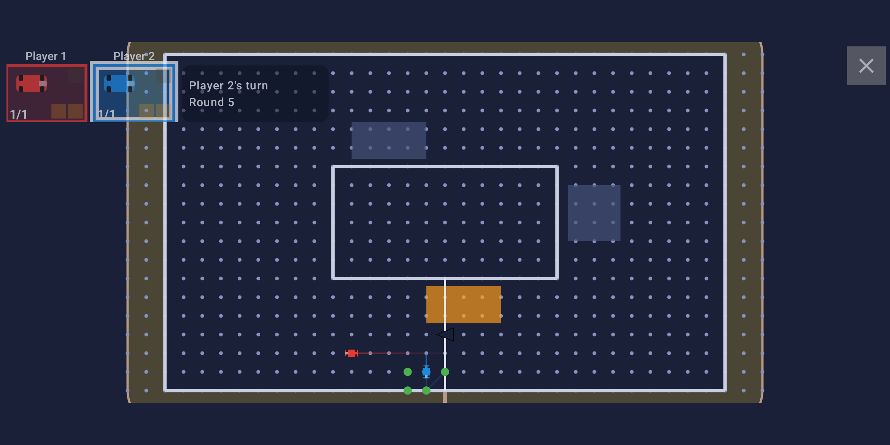
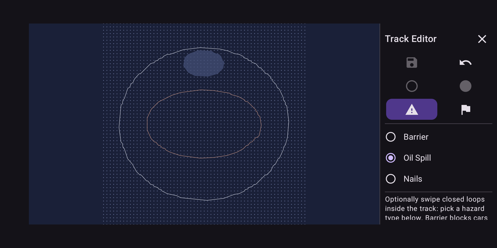
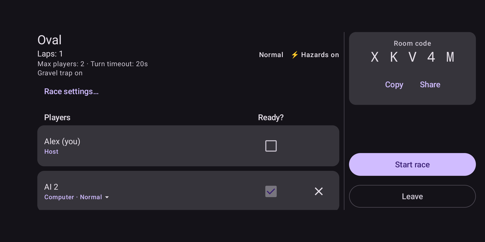

# Grid Racer

A turn-based vector-racing game for Android — the pencil-and-paper "paper race"
game, played on a grid. Each turn you pick a velocity vector: one of the nine
points reachable from where your last move would carry you. Walls, other cars,
oil, nails and lap counting are enforced by a pure rules engine.

Grid Racer has local play (single-player, hot-seat and AI opponents), a track
editor, and optional online multiplayer with accounts, an Elo leaderboard and a
shared track library.

- **Website and legal documents:** https://piepgras.info/apps/grid-racer/
- **Google Play:** https://play.google.com/store/apps/details?id=info.piepgras.gridracer
- **Licence:** [MIT](LICENSE)

| Racing | Drawing a track | Online lobby |
|---|---|---|
|  |  |  |

## Modules

| Module | What it is |
|---|---|
| `shared/` | The rules engine, the wire protocol and the replay format. Kotlin Multiplatform (JVM + Android targets), no platform dependencies — geometry, tracks and track validation, race state, AI and scoring; the client-server messages; the replay format the server writes and the app reads. |
| `app/` | The Android client: Jetpack Compose UI, track editor, settings, multiplayer client. |
| `server/` | The multiplayer server: Ktor + WebSockets, SQLite over plain JDBC, accounts with PBKDF2 password hashing, rate limiting, Elo and track sharing. |
| `tools/tutorial-editor/` | A local browser tool for authoring the app's "How to play" animations; it generates the Compose code in `app/.../ui/howtoplay/`. |
| `scripts/` | Asset generation — sound effects, launcher icon, feature graphic — and the legal-document renderer. |

The engine is deliberately free of Android imports so it can be unit-tested on
the JVM and reused by the server: the same code decides a move's legality on
the phone and on the server, which is what keeps an online race consistent.

## Building

Requires JDK 17 or newer (the Gradle daemon toolchain asks for JDK 25) and the
Android SDK with API 37. Put the SDK path in `local.properties`:

```properties
sdk.dir=/path/to/Android/Sdk
```

```bash
./gradlew :app:assembleDebug        # build the debug APK
./gradlew :shared:jvmTest           # engine unit tests
./gradlew :server:test              # server tests
./gradlew :app:testDebugUnitTest    # app unit tests
./gradlew :app:lintDebug            # Android lint — keep the error count at zero
./gradlew :server:run               # run the multiplayer server on :8080
```

`minSdk` is 26, `targetSdk` 37.

### Crash reporting is off in a source build

Release builds published by piepgras.info report crashes to a self-hosted,
Sentry-compatible instance, but only after the user opts in. The endpoint is
supplied at build time and is **not** in this repository, so a build made from
source has crash reporting compiled out entirely — which is the intended
behaviour: your fork's crashes are not the upstream maintainer's to receive.

To point a build at your own Sentry-compatible instance, add its DSN to
`local.properties`:

```properties
sentry.dsn=https://<key>@<your-host>/<project>
```

## Running your own server

The app connects to the public server by default, encrypted
(`wss://gridracer.piepgras.info/play`, set in `shared/.../engine/Settings.kt`), and a
player can point it anywhere under **Settings → Server**: `wss://` for a server with a
certificate, or plain `ws://` for one on a home network, which the app allows and marks as
unencrypted. To run your own:

```bash
./gradlew :server:run
```

Configuration is read from environment variables; see
[`server/README.md`](server/README.md) for the full list, the deployment
bundle and the database layout.

## Licence

Grid Racer is released under the **MIT License** — see [LICENSE](LICENSE). You
may use, copy, modify, merge, publish, distribute, sublicense and sell it,
including inside commercial and closed-source work, provided the copyright
notice and the licence text travel with every substantial copy.
[THIRD-PARTY-NOTICES.md](THIRD-PARTY-NOTICES.md) lists the libraries it builds
on and their own licences.

It is provided "as is", **without warranty of any kind** — see the licence text.

### The published app's own terms

`legal/terms-of-service.md` is written for this licence: section 4 points at the
MIT License, and the terms govern only the *service* - the server, accounts and
uploaded content - never what you may do with the software. Builds on Google Play
up to and including 1.2 shipped an older text granting only personal,
non-commercial use of *that binary*; it never restricted this source code, and
1.3 is the first release to carry the new terms in the app.

### Name and artwork

The MIT licence is a copyright licence; it grants **no trademark rights**. The
name "Grid Racer" and the launcher icon and store artwork *as identifiers of this
app* are not licensed for branding a redistributed build. Fork freely — the
generator scripts and the artwork files are as MIT-licensed as the rest — but
publish your fork under its own name and its own icon, so that nobody installs
your version thinking it is this one, and so that support requests reach
whoever can actually answer them.

## Contributing

See [CONTRIBUTING.md](CONTRIBUTING.md). Security reports go to
apps@piepgras.info rather than the issue tracker — see [SECURITY.md](SECURITY.md).

---

© piepgras.info · Contact: apps@piepgras.info
